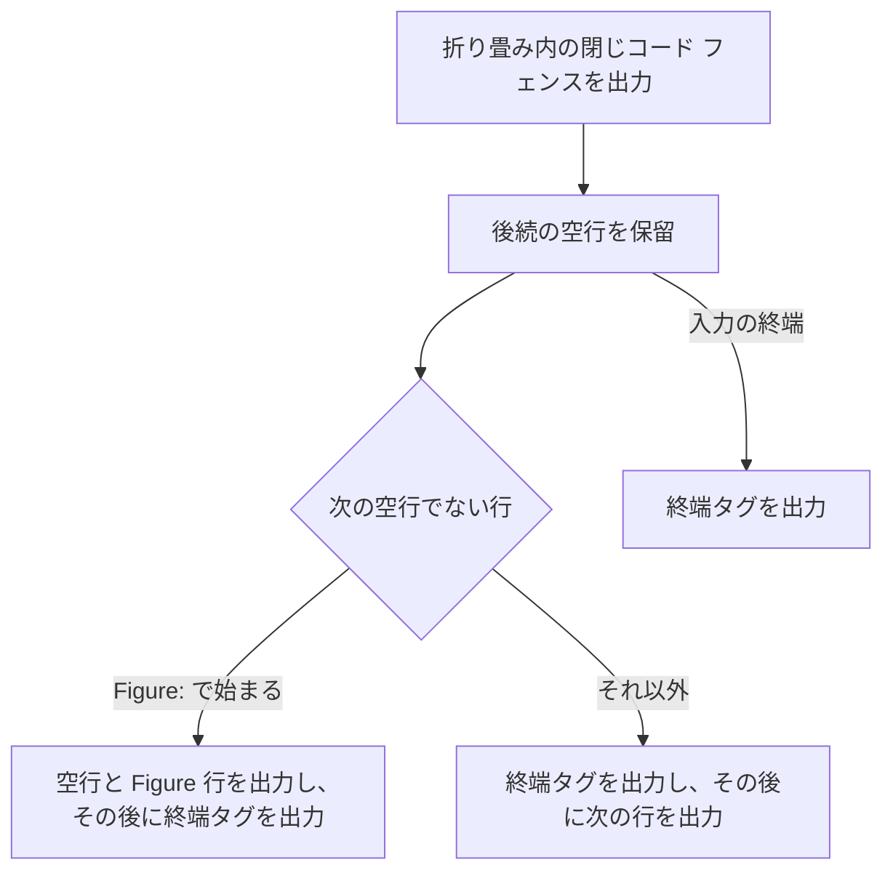
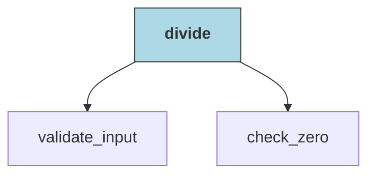

# doxybook2 への Mermaid 対応

Doxygen XML の `<mermaid>` タグを、Doxybook2 へ渡す前に Mermaid のコード フェンスと `Figure:` 行のテキストへ置き換えます。  
Doxybook2 v1.6.1 は `<mermaid>` タグを認識せず、`[warning] Text tag "mermaid" not recognised, please contact the author` を出力してタグを取り除くため、図が Markdown に残りません。XML 段階でテキストへ置き換えることで、警告を出さずに図とキャプションを Markdown へ出力します。

互換の記法である PlantUML (`<plantuml>` タグ) の変換は [doxybook2 への PlantUML 対応](doxybook2-plantuml.md) を参照してください。

## mermaid タグの 3 つの発生源

`<mermaid>` タグは、次の 3 つの発生源から Doxygen XML へ現れます。変換処理は発生源を区別せず、すべての `<mermaid>` タグを同じ規則で変換します。

Table: `<mermaid>` タグの発生源と変換結果

| 発生源 | XML 上の形式 | 変換結果 |
|---|---|---|
| Doxygen コメントの `@mermaid "キャプション"` 〜 `@endmermaid` | `caption` 属性付きの `<mermaid>` | コード フェンスと `Figure:` 行 |
| [extract-graphs.py](extract-graphs.md) が挿入する自動生成グラフ | `caption` 属性付きの `<mermaid>` | コード フェンスと `Figure:` 行 |
| Doxygen の入力となる Markdown の ```` ```mermaid ```` コード フェンス | `caption` 属性のない `<mermaid>` | コード フェンスだけ |

`@mermaid` の書き方は [コマンド一覧](commands.md) の `@mermaid "<caption>" ~ @endmermaid` を参照してください。

> [!NOTE]
> 入力 Markdown のページは、`postprocess.sh` が Doxybook2 の出力を破棄し、入力の Markdown を複製して置き換えます。このため、この発生源の変換は最終出力の内容に影響せず、Doxybook2 の警告を解消することが目的です。入力 Markdown の図のキャプションは、入力の Markdown に記載した `Figure:` 行がそのまま使われます。

## 変換ヘルパー (convert-mermaid-tags.py)

`templates/convert-mermaid-tags.py` は、XML フォルダーを引数に取り、配下の XML ファイルに含まれる `<mermaid>` タグを変換します。

### 呼び出し位置

`preprocess.sh` は、`fix-anonymous-enums.py` の呼び出しの後、XML ファイルごとに `sed` で変換するループより前で、変換ヘルパーを 1 回呼び出します。

```bash
python3 "$SCRIPT_DIR/convert-mermaid-tags.py" "$XML_FOLDER"
```

変換ヘルパーは、フォルダー配下の拡張子 `.xml` のファイルを再帰的に処理します。`<mermaid` を含まないファイルと、変換しても内容が変わらないファイルは書き換えません。  
ループ内の `sed` による変換 (`<plantuml>`、`<bold>`、`<name>`、`<title>` など) は、変換後のコード フェンスがこれらのタグを含まないため、Mermaid の図に干渉しません。

### 変換規則

変換ヘルパーは、`<mermaid([^>]*)>(.*?)</mermaid>` に一致するブロック (複数行にわたる一致を含む) を、次の規則で変換します。

- **キャプション**: 開始タグの `caption="..."` 属性を取り出し、XML の実体参照を復号して前後の空白を除きます。属性がない場合と、空白を除いた結果が空文字列の場合は、キャプションなしとして扱います。
- **本文**: 先頭と末尾の空行と各行の末尾の空白を除き、全行に共通する字下げを取り除きます。本文中の XML の実体参照 (`&gt;` など) は復号せずに保持し、Doxybook2 の復号に任せます。
- **出力**: ブロックを次のテキストへ置き換えます。前後に空行を置き、隣接するテキストと行が連結しないようにします。キャプションなしの場合は、`Figure:` 行とその直後の空行を出力しません。

````text
(空行)
```mermaid
{本文}
```
(空行)
Figure: {エスケープ済みのキャプション}
(空行)
````

Doxygen コメントの `@mermaid "Foo<T>::operator* の図"` から生成された XML は、次のように変換されます。

````text
変換前 (XML):
<para><mermaid caption="Foo&lt;T&gt;::operator* の図">    flowchart TD
        n0["a"] --&gt; n1["b"]
</mermaid></para>

変換後 (XML):
<para>

```mermaid
flowchart TD
    n0["a"] --&gt; n1["b"]
```

Figure: Foo&amp;#60;T&amp;#62;::operator&amp;#42; の図

</para>
````

Doxybook2 は実体参照を復号するため、Markdown には `n0["a"] --> n1["b"]` と `Figure: Foo&#60;T&#62;::operator&#42; の図` が出力されます。

### キャプションのエスケープ

`Figure:` 行はコード フェンスの外にあり、Markdown の本文として解釈されます。名前に含まれる記号 (`Foo<T>`、`operator*`、`operator[]` など) を文字どおりに表示するため、変換ヘルパーは次の 8 種の記号を数値文字参照へ変換します。Doxygen コメントのキャプションと自動生成グラフのキャプションに、同じ規則を適用します。

Table: キャプション内の記号と数値文字参照の対応

| 記号 | 変換後 | 記号 | 変換後 |
|---|---|---|---|
| `\` | `&#92;` | `>` | `&#62;` |
| `` ` `` | `&#96;` | `[` | `&#91;` |
| `*` | `&#42;` | `]` | `&#93;` |
| `<` | `&#60;` | `~` | `&#126;` |

- 変換後の文字列は、XML のテキストとしてエスケープして書き込みます。`&#42;` は XML 上で `&amp;#42;` となり、Doxybook2 が復号して Markdown へ `&#42;` を出力します。
- `__` と `$` は変換ヘルパーでは変換しません。`postprocess.sh` が、コード フェンス外の本文に対して `__` を `&#95;&#95;` へ、`$` を `\$` へ変換します。

> [!NOTE]
> キャプションの記号は、バックスラッシュによるエスケープ (`\[` など) ではなく数値文字参照で表します。`postprocess.sh` には、行の途中にある `\[` を LaTeX のブロック数式の開始とみなして前後を別の行へ分離する処理があり、`\[` を含むキャプション行が分断されるためです。数値文字参照は、`postprocess.sh` が `__` を `&#95;&#95;` へ変換する方式と同じ手段です。

## postprocess.sh での扱い

`postprocess.sh` は、Doxybook2 が出力した Markdown の Mermaid のコード フェンスと `Figure:` 行を、次のように扱います。

### コード フェンス内の保護

- **`__` の保護**: `preprocess.sh` が `!dunder!` へ退避した `__` は、```` ```plantuml ```` 以外のコード フェンスでは `__` へ戻すだけで、`__` 自体は変換しません。Mermaid のコード フェンスもこの扱いとなり、ラベル内の `__` はそのまま残ります。
- **`fix_ptr` の除外**: ポインター型の空白を正規化する `fix_ptr` は、コード フェンス内の二重引用符の外側へ適用されます。開始行が `^[[:space:]]*```[[:space:]]*mermaid([[:space:]]|$)` に一致するコード フェンスの内側では、`fix_ptr` を適用しません。シーケンス図のメッセージのように、引用符で囲まないテキストに `*` を含む図 (`A->>B: a* b` など) を書き換えないためです。

`Figure:` 行はコード フェンスの外にあるため、ほかの本文と同じく `__` を `&#95;&#95;` へ、`$` を `\$` へ変換します。

### 詳細版だけに表示するグラフの折り畳み

`extract-graphs.py` は、詳細版だけに表示するグラフの見出しの先頭に `DOXYFW_DETAILS_ONLY` を付与します。`postprocess.sh` はこの見出しを検出し、見出し、グラフのコード フェンス、直後の `Figure:` 行を `<!--details:-->` と `<!--:details-->` で囲みます。  
`Figure:` 行はコード フェンスの外にあるため、閉じコード フェンスの直後で折り畳みを閉じると、キャプションだけが折り畳みの外に残ります。これを避けるため、`postprocess.sh` は次の順で終端タグを出力します。

1. 折り畳みの内側で閉じコード フェンスを出力した後、すぐには `<!--:details-->` を出力せず、後続の空行を保留します。
2. 次の空行でない行が `Figure:` で始まる場合は、空行と `Figure:` 行を出力し、その後に空行と `<!--:details-->` を出力します。
3. 次の空行でない行が `Figure:` で始まらない場合は、空行と `<!--:details-->` を出力してから、空行とその行を出力します。入力の終端に達した場合は、空行と `<!--:details-->` を出力します。



Figure: 折り畳みの終端と `Figure:` 行の出力順

見出しは、`postprocess.sh` が単位項目内の `####` 見出しを太字へ変換する処理により、太字の段落として出力されます。呼び出し先グラフの出力は次のとおりです。

````markdown
<!--details:-->

**呼び出し先**



Figure: divide の呼び出し先

<!--:details-->
````

## Doxygen HTML での描画

Doxyfile には `MERMAID_*` の設定を記載せず、既定の `MERMAID_RENDER_MODE = AUTO` を使用します。

> [!IMPORTANT]
> Doxygen が生成する HTML では、Doxygen コメントの Mermaid 図は、閲覧時に CDN (`cdn.jsdelivr.net`) から mermaid を読み込んで描画されます。CDN へ接続できない端末では図が描画されません。  
> 自動生成グラフは Doxygen の実行後に XML へ挿入するため、Doxygen HTML には現れません。Doxybook2 を経由する Markdown は、この制約の影響を受けません。

## 関連文書

- [Doxygen 関連図の Markdown 挿入](extract-graphs.md) - 自動生成グラフの Mermaid の生成規則
- [doxybook2 への PlantUML 対応](doxybook2-plantuml.md) - 互換の変換経路である PlantUML の変換
- [コマンド一覧](commands.md) - `@mermaid` の書き方と字下げの規則
- [コード ブロックと図のキャプション](../../docsfw/docs/codeblock-caption.md) - `Figure:` 行の記法
