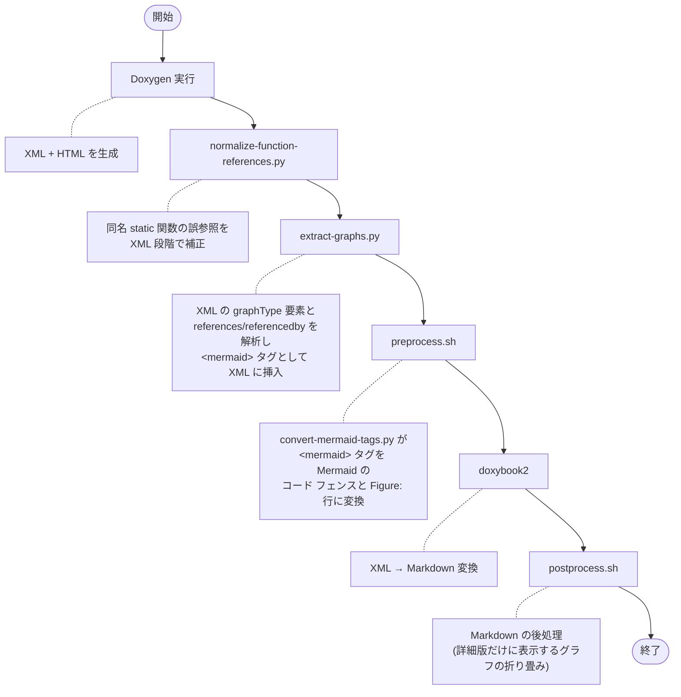
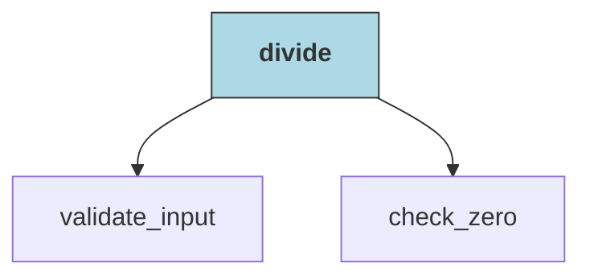
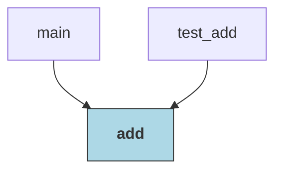
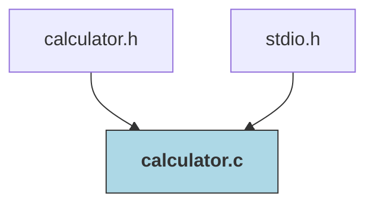
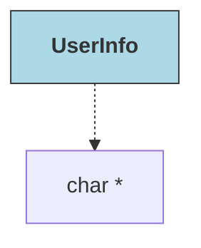

# Doxygen 関連図の Markdown 挿入

このドキュメントでは、Doxygen が生成するグラフ情報を Markdown 版ドキュメントに Mermaid の図として自動挿入する仕組みについて説明します。

## 背景

Doxygen は HTML ドキュメント生成時に Graphviz (dot) を用いてコールグラフ、インクルード依存図、コラボレーション図などの SVG 画像を生成します。しかし、Doxybook2 を経由した Markdown 変換ではこれらのグラフ情報が失われます。

Doxybook2 はグラフ データをテンプレート変数として公開しておらず、プロジェクト自体も 2022 年にアーカイブされているため、今後の機能追加は見込めません。

本機能は、Doxygen XML に含まれるグラフ構造データを解析し、Mermaid の `flowchart` に変換して Markdown ドキュメントに挿入することで、この課題を解決します。

## 処理パイプライン

グラフ抽出は、既存のドキュメント生成パイプラインに統合されています。



Figure: グラフ抽出を含むドキュメント生成パイプライン

`cd framework/doxyfw && make` を実行すると、`extract-graphs.py` は `preprocess.sh` の前に自動的に呼び出されます。  
生成された `<mermaid>` タグは、`preprocess.sh` から呼び出される `convert-mermaid-tags.py` によって Mermaid のコード フェンスと `Figure:` 行に変換されます。変換の詳細は [doxybook2 への Mermaid 対応](doxybook2-mermaid.md) を参照してください。

## 対応するグラフの種類

### ファイル レベルのグラフ

| グラフ種別 | XML ソース要素 | 説明 |
|---|---|---|
| インクルード依存 | `incdepgraph` | 対象ファイルがインクルードしているファイルの関係を示します |
| 被インクルード関係 | `invincdepgraph` | 対象ファイルをインクルードしているファイルの関係を示します |

Table: ファイル レベルのグラフ種別と XML ソース要素

### クラス/構造体レベルのグラフ

| グラフ種別 | XML ソース要素 | 説明 |
|---|---|---|
| 継承関係 | `inheritancegraph` | クラスの継承階層を示します |
| コラボレーション図 | `collaborationgraph` | クラス/構造体のメンバー型の関連を示します |

Table: クラスおよび構造体レベルのグラフ種別と XML ソース要素

### 関数レベルのグラフ

| グラフ種別 | XML ソース要素 | 説明 |
|---|---|---|
| コールグラフ | `references` | 対象関数が呼び出す関数を示します |
| 呼び出し元グラフ | `referencedby` | 対象関数を呼び出す関数を示します |

Table: 関数レベルのグラフ種別と XML ソース要素

## Doxygen XML のグラフ データ構造

### graphType 要素

`incdepgraph`、`invincdepgraph`、`inheritancegraph`、`collaborationgraph` は共通の `graphType` 構造を持ちます。

```xml
<incdepgraph>
  <node id="1">
    <label>calculator.c</label>
    <link refid="calculator_8c"/>
    <childnode refid="2" relation="include"/>
    <childnode refid="3" relation="include"/>
  </node>
  <node id="2">
    <label>calculator.h</label>
    <link refid="calculator_8h"/>
  </node>
  <node id="3">
    <label>stdio.h</label>
  </node>
</incdepgraph>
```

`node` 要素がグラフのノードを定義し、`childnode` 要素がノード間のエッジを定義します。`relation` 属性はエッジの種類を表します。

`relation` 属性の値と Mermaid の矢印の対応は次のとおりです。

| relation 値 | 意味 | Mermaid の矢印 |
|---|---|---|
| `include` | インクルード関係 | `-->` |
| `usage` | メンバー使用関係 | `-.->` |
| `public-inheritance` | public 継承 | `-->` |
| `protected-inheritance` | protected 継承 | `-->` |
| `private-inheritance` | private 継承 | `-->` |

Table: relation 属性値と Mermaid の矢印の対応

`usage` だけを破線の矢印 `-.->` で表し、それ以外の値はすべて実線の矢印 `-->` で表します。  
継承は矢印の形では区別せず、`flowchart BT` の宣言によって基底クラスを上に配置します。

### references / referencedby 要素

関数間の呼び出し関係は、`memberdef` 要素の子要素として格納されます。

```xml
<memberdef kind="function" id="calculator_8c_1a001">
  <name>add</name>
  <!-- 略 -->
  <references refid="calculator_8c_1a005" compoundref="calculator_8c"
              startline="10" endline="10">validate_input</references>
  <referencedby refid="main_8c_1a099" compoundref="main_8c"
                startline="25" endline="25">main</referencedby>
</memberdef>
```

`references` は対象関数が呼び出す関数を、`referencedby` は対象関数を呼び出す関数を表します。

非ヘッダーのソース ファイルに属する関数ノードは、ラベルにファイル注記を付与し、`funcname<br/>(file.c)` のように関数名とファイル名を 2 行で表示します。  
同一グラフ内で同名ファイルが複数現れる場合は、`add/add.c` や `calcbase/add.c` のように、後方パスを 1 要素ずつ広げて最短一意表記にします。  
また、グラフ内で重複がなくても、注記対象のファイル名が起点ノードの所属ファイル名と同じ場合は同じ規則で後方パスを付与します。

これらの要素を XML に含めるには、Doxyfile で次の設定が必要です。

```text
REFERENCED_BY_RELATION = YES
REFERENCES_RELATION    = YES
```

## Mermaid の生成規則

### 図の宣言と向き

すべてのグラフ種別を `flowchart` で出力します。宣言の向きと矢印は、グラフ種別ごとに次のとおりです。

| グラフ種別 | Mermaid の宣言 | 矢印 | 配置 |
|---|---|---|---|
| インクルード依存 (`incdepgraph`) | `flowchart TD` | `-->` | XML の `node` から `childnode` への向きを逆にして出力し、対象ファイルを下に配置します |
| 被インクルード関係 (`invincdepgraph`) | `flowchart TD` | `-->` | XML の `node` から `childnode` への向きのまま出力します |
| 継承関係 (`inheritancegraph`) | `flowchart BT` | `-->` | 派生から基底へ向け、基底を上に配置します |
| コラボレーション図 (`collaborationgraph`) | `flowchart TD` | `usage` は `-.->`、それ以外は `-->` | XML の `node` から `childnode` への向きのまま出力します |
| コールグラフ (`references`) | `flowchart TD` | `-->` | 呼び出し元から呼び出し先へ向けます |
| 呼び出し元グラフ (`referencedby`) | `flowchart TD` | `-->` | 呼び出し元から呼び出し先へ向けます |

Table: グラフ種別ごとの Mermaid の宣言と矢印

### ノード ID とラベル

ノード ID は、接頭辞 `n` と 0 からの連番 (`n0`、`n1`、...) です。Mermaid の予約語や記号と衝突しないよう、Doxygen のノード ID や関数名は ID に使用しません。

ノードは `n0["ラベル"]` の形式で定義し、ラベルを必ず二重引用符で囲みます。  
ラベルは、XML の実体参照を復号した後、次の順で変換します。

1. `&` を `&amp;`、`<` を `&lt;`、`>` を `&gt;`、`"` を `#quot;` へ置き換えます。
2. ラベル内の改行 (ファイル注記の区切り) を `<br/>` へ置き換えます。

たとえば、ラベル `Foo<T>` は `n0["Foo&lt;T&gt;"]` として出力します。

### 対象ノードの強調

グラフの起点となる要素自身 (対象ファイル、対象クラス、対象関数) のノードは、ノード定義の後に次の `style` 行を出力して強調します。ラベル内には太字の記法を出力しません。

```text
style n0 fill:#ADD8E6,stroke:#333,font-weight:bold
```

## 生成される Mermaid の例

### コールグラフ

関数 `divide` が `validate_input` と `check_zero` を呼び出す場合、次の Mermaid が生成されます。



Figure: divide の呼び出し先

### 呼び出し元グラフ

関数 `add` が `main` と `test_add` から呼び出される場合、次の Mermaid が生成されます。



Figure: add の呼び出し元

### インクルード依存グラフ

`calculator.c` が `calculator.h` と `stdio.h` をインクルードする場合、次の Mermaid が生成されます。  
エッジを逆向きに出力するため、対象の `calculator.c` は図の下に配置されます。



Figure: calculator.c のインクルード元

### コラボレーション図

構造体 `UserInfo` が `char *` 型のメンバーを持つ場合、次の Mermaid が生成されます。



Figure: UserInfo のコラボレーション図

## 設定と制御

### グラフ生成の制御

グラフの生成は Doxyfile の設定によって制御されます。

| Doxyfile 設定 | 対応するグラフ |
|---|---|
| `INCLUDE_GRAPH = YES` | インクルード依存グラフ |
| `INCLUDED_BY_GRAPH = YES` | 被インクルード関係グラフ |
| `CLASS_GRAPH = YES` | 継承グラフ |
| `COLLABORATION_GRAPH = YES` | コラボレーション図 |
| `REFERENCES_RELATION = YES` | コールグラフ |
| `REFERENCED_BY_RELATION = YES` | 呼び出し元グラフ |

Table: Doxyfile 設定項目と生成対象グラフの対応

これらの設定を `NO` にすると、対応する XML 要素が生成されなくなり、Markdown への図の挿入もスキップされます。

### ノード数の上限

`extract-graphs.py` では、グラフあたりの最大ノード数を 50 に設定しています。この値は Doxygen の `DOT_GRAPH_MAX_NODES` (既定 50) に合わせています。この値を超えるグラフは生成をスキップします。上限値はスクリプト先頭の `DOT_GRAPH_MAX_NODES` 定数で変更できます。

```python
# グラフあたりの最大ノード数 (これを超えるグラフは生成しない)
# Doxygen の DOT_GRAPH_MAX_NODES (既定値 50) に合わせた値
DOT_GRAPH_MAX_NODES = 50
```

### インクルード グラフのラベル表示モード

インクルード依存グラフ・被インクルード関係グラフのノード ラベルを、グラフ内で最短一意になる後方パスにするか完全なパスにするかを制御できます。スクリプト先頭の `INC_GRAPH_LABEL_BASENAME_ONLY` 定数で設定します。

```python
# インクルード依存グラフ・被インクルード関係グラフのノード ラベル表示モード
# True : グラフ内で最短一意になる後方パスで表示
# False: 完全なパスをそのまま表示
INC_GRAPH_LABEL_BASENAME_ONLY = True
```

既定値は `True` です。このモードでは basename を起点にして、必要なときだけ親ディレクトリ名を付与します。完全なパスで表示したい場合は `False` に変更してください。

### 詳細版だけに表示するグラフ

スクリプト先頭の `GRAPH_DETAILS_ONLY` 定数で、グラフ種別ごとに詳細版のドキュメントだけに表示するかどうかを設定します。既定値はすべてのグラフ種別で `True` です。

`True` のグラフ種別では、見出しの先頭に `DOXYFW_DETAILS_ONLY` を付与します。`postprocess.sh` はこの見出しを検出し、見出しから `Figure:` 行までを `<!--details:-->` と `<!--:details-->` で囲みます。折り畳みの出力形式は [doxybook2 への Mermaid 対応](doxybook2-mermaid.md) を参照してください。

### スキップ条件

次の条件に該当する場合、グラフの生成はスキップされます。

- ノード数が `DOT_GRAPH_MAX_NODES` を超える場合
- エッジが 1 つもない場合 (ノードが 1 つだけで関係のないグラフ)
- `index.xml` や `combine.xslt` などのインデックス ファイル

## 技術的な詳細

### XML 書式の保持

`extract-graphs.py` は XML の解析に正規表現ベースのテキスト操作を使用しています。ElementTree などの XML パーサーを用いた場合、ファイル再書き込み時に属性の順序変更、空要素の展開、名前空間宣言の変更などが発生する可能性があります。正規表現による操作は、変更箇所以外の XML 書式を完全に保持します。

### 挿入位置と見出し

生成された `<mermaid>` タグは、対象要素の `<detaileddescription>` 閉じタグの直前に `<simplesect kind="par">` 要素で囲んで挿入されます。Doxybook2 の `details.tmpl` はこれを `par` セクションとして処理し、`<title>` の文字列を `####` 見出しとして出力します。`postprocess.sh` は単位項目内の `####` 見出しを太字の段落 (`**呼び出し先**` など) へ変換します。

compound レベルのグラフ (インクルード依存図など) は、`content.rfind()` により compounddef 自身の `</detaileddescription>` を検索するため、memberdef 内ではなく正しい位置に挿入されます。

`<title>` の見出しと、`<mermaid>` の `caption` 属性のキャプションは別の文字列です。見出しはグラフ種別の名称、キャプションは `<名前> の<見出し>` です。

| グラフ種別 | 見出し | キャプションの例 |
|---|---|---|
| インクルード依存 (`incdepgraph`) | `インクルード元` | `calculator.c のインクルード元` |
| 被インクルード関係 (`invincdepgraph`) | `インクルード先` | `calculator.h のインクルード先` |
| 継承関係 (`inheritancegraph`) | `継承関係` | `Derived の継承関係` |
| コラボレーション図 (`collaborationgraph`) | `コラボレーション図` | `UserInfo のコラボレーション図` |
| 呼び出し元グラフ (`referencedby`) | `呼び出し元` | `add の呼び出し元` |
| コールグラフ (`references`) | `呼び出し先` | `divide の呼び出し先` |

Table: グラフ種別ごとの見出しとキャプション

ファイル レベルのグラフの `<名前>` はファイルの basename、クラス/構造体レベルのグラフはコンパウンド名、関数レベルのグラフは関数名です。  
`GRAPH_DETAILS_ONLY` が `True` のグラフ種別では、見出しの先頭に `DOXYFW_DETAILS_ONLY` を付与します。

```xml
<detaileddescription>
<para>既存の説明テキスト</para>
<para><simplesect kind="par"><title>DOXYFW_DETAILS_ONLY 呼び出し先</title><para><mermaid caption="divide の呼び出し先">
flowchart TD
    n0["divide"]
    n1["validate_input"]
    n2["check_zero"]
    style n0 fill:#ADD8E6,stroke:#333,font-weight:bold
    n0 --&gt; n1
    n0 --&gt; n2
</mermaid></para></simplesect></para>
</detaileddescription>
```

キャプションは XML の属性値として `&`、`<`、`>`、`"` をエスケープします。Mermaid の本文は XML のテキストとして `&`、`<`、`>` をエスケープするため、矢印 `-->` は XML 上で `--&gt;` となります。ラベルの `&lt;` は XML 上で `&amp;lt;` となり、Doxybook2 が復号して Markdown へ `&lt;` を出力します。

### Mermaid 変換の流れ

挿入された `<mermaid>` タグは、`preprocess.sh` から呼び出される `convert-mermaid-tags.py` によって、Mermaid のコード フェンスと `Figure:` 行のテキストに変換されます。

````text
変換前 (XML):
<mermaid caption="divide の呼び出し先">
flowchart TD
    ...
    n0 --&gt; n1
</mermaid>

変換後 (テキスト):
```mermaid
flowchart TD
    ...
    n0 --&gt; n1
```

Figure: divide の呼び出し先
````

Doxybook2 は本文の実体参照を復号してテキストとして Markdown に出力するため、最終的な Markdown ファイルには Mermaid のコード フェンス (`n0 --> n1`) と `Figure:` 行が含まれます。キャプションのエスケープと、`postprocess.sh` での扱いは [doxybook2 への Mermaid 対応](doxybook2-mermaid.md) を参照してください。
